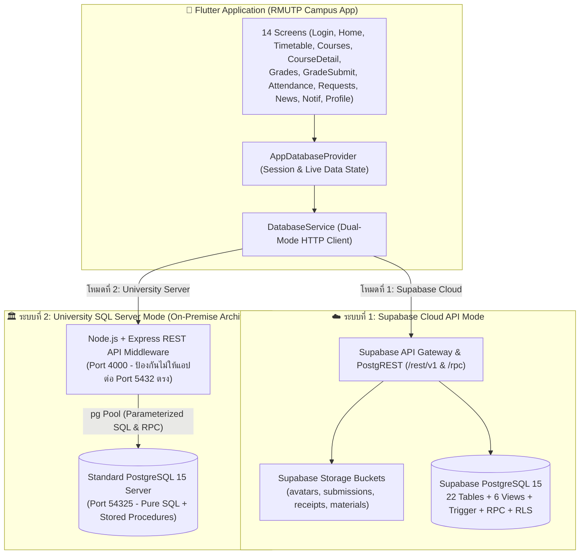

# 🗄️ คู่มือระบบฐานข้อมูลมหาวิทยาลัย 2 ระบบ (RMUTP Dual-Database Architecture Guide)

เอกสารฉบับนี้ออกแบบมาสำหรับ **ทีมพัฒนา Database & Backend** และ **ทีม Flutter Frontend** ของโปรเจกต์จบ **แอปพลิเคชันมหาวิทยาลัยเทคโนโลยีราชมงคลพระนคร (RMUTP Campus App)** โดยรองรับการทำงาน **2 ระบบควบคู่กัน (Dual-Database Architecture)** พร้อมใช้งานทั้งบน Cloud API และเซิร์ฟเวอร์ฐานข้อมูลจริงของมหาวิทยาลัย

---

## 📌 1. สถาปัตยกรรม 2 ระบบควบคู่กัน (Dual-System Architecture)



---

## 📂 2. โครงสร้างไฟล์ฐานข้อมูลและ Backend ในโปรเจกต์

| ระบบ / ส่วนประกอบ | ที่อยู่ไฟล์ | หน้าที่หลัก |
| :--- | :--- | :--- |
| **ระบบที่ 1: Supabase Cloud** | [full_supabase_setup.sql](file:///e:/Project-APP_RMUTP/database/supabase_cloud/full_supabase_setup.sql) | สคริปต์ **All-in-One SQL** รวมทุกอย่างในไฟล์เดียว (22 ตาราง 3NF + 6 Views + Trigger ตัดเกรด + RPC ล็อกอิน `sp_authenticate_user` + 4 Storage Buckets + ข้อมูลจำลองนักศึกษา 12 คน/อาจารย์ 4 ท่าน + RLS Security) |
| **ระบบที่ 2: University SQL** | [01_standard_sql_setup.sql](file:///e:/Project-APP_RMUTP/database/university_sql_server/01_standard_sql_setup.sql) | สคริปต์ **Pure Standard PostgreSQL** สำหรับเซิร์ฟเวอร์จริงของมหาวิทยาลัย (ไม่มีคำสั่งเฉพาะของ Supabase) |
| **ระบบที่ 2: Express Middleware** | [server.js](file:///e:/Project-APP_RMUTP/database/university_sql_server/api_server/server.js) | **Node.js + Express REST API Middleware** เชื่อมต่อ PostgreSQL ด้วย `pg.Pool` และ Parameterized Queries ป้องกัน SQL Injection |
| **ระบบที่ 2: Docker จำลอง ม.** | [docker-compose.university.yml](file:///e:/Project-APP_RMUTP/database/university_sql_server/docker-compose.university.yml) | ชุดรันจำลองเซิร์ฟเวอร์ PostgreSQL ของมหาวิทยาลัยคู่กับ Express API บนพอร์ต `4000` |
| **การตั้งค่า Flutter DB** | [database_config.dart](file:///e:/Project-APP_RMUTP/lib/services/database_config.dart) | จัดการสลับโหมด 2 ระบบ และตัด `/rest/v1` ท้าย URL อัตโนมัติ |
| **Service & State กลาง** | [database_service.dart](file:///e:/Project-APP_RMUTP/lib/services/database_service.dart) / [app_database_provider.dart](file:///e:/Project-APP_RMUTP/lib/providers/app_database_provider.dart) | ยิง REST API / RPC อ่าน-เขียนข้อมูลจริงเข้าทุกหน้าจอในแอป Flutter |

---

## 📐 3. พจนานุกรมข้อมูลฉบับสมบูรณ์ (Data Dictionary: 22 Tables, 6 Views, Triggers, RPC & Storage)

ฐานข้อมูลออกแบบตามหลัก **Normalization ระดับ 3NF (Third Normal Form)** แบ่งเป็น **8 โมดูล 22 ตารางหลัก**:

| โมดูล | ตาราง (Tables) | คำอธิบายข้อมูลสำคัญ |
| :--- | :--- | :--- |
| **1. โครงสร้างมหาวิทยาลัย** | `faculties`, `departments`, `curriculums`, `buildings_rooms` | คณะวิชา 4 คณะ, สาขาวิชา 6 สาขา, หลักสูตรการศึกษา (`B.Eng-CE-2565`), อาคารและห้องเรียนจริง (`ห้อง 1604`, `Lab 1502`, `ออนไลน์ MS Teams`) |
| **2. ปฏิทินการศึกษา** | `academic_terms`, `academic_calendar_events` | ปีการศึกษา/ภาคเรียน (`2/2568`, `1/2569`), วันสอบกลางภาค-ปลายภาค, วันหมดเขตส่งเกรด, ปฏิทินวิชาการ |
| **3. ผู้ใช้และทะเบียนประวัติ** | `users`, `teachers`, `students` | บัญชีผู้ใช้ (`password_hash` เข้ารหัส `bcrypt`), ข้อมูลอาจารย์ 4 ท่าน (`T-1024`–`T-1027`), ประวัตินักศึกษาเชิงลึก 12 คน (`650602001`–`650602012`: บัตร ปชช., วันเกิด, กรุ๊ปเลือด, รูปถ่าย, ที่อยู่, ผู้ติดต่อฉุกเฉิน, GPAX, หน่วยกิตสะสม) |
| **4. รายวิชาและผลการเรียน** | `subjects`, `course_sections`, `enrollments` | รายวิชา 9 วิชา, กลุ่มเรียนแยกตามวันจันทร์–ศุกร์ (`MON`–`FRI`), การลงทะเบียน, คะแนนย่อย, คะแนนเก็บ (`/30`), กลางภาค (`/30`), ปลายภาค (`/40`), เกรด (`A`–`F`), สถานะส่งเกรด |
| **5. สื่อการสอนและการบ้าน** | `course_materials`, `assignments`, `assignment_submissions` | สไลด์/ไฟล์ PDF ประกอบการสอน, การบ้าน (`HW6`, `Lab 6`), ประวัติการแนบไฟล์ส่งงานของนักศึกษา |
| **6. ระบบเช็กชื่อเข้าเรียน** | `attendance_sessions`, `attendance_records` | ห้องเช็กชื่อ (`DB-0921`), QR Payload, เวลาเปิด-ปิดรับเช็กชื่อ, สถานะรายคน (`present`, `late`, `absent`, `leave`) |
| **7. การเงินและใบเสร็จ** | `tuition_invoices`, `payment_receipts` | ใบแจ้งหนี้ค่าเทอม (`INV-...`), ส่วนลดทุน, ใบเสร็จรับเงินอิเล็กทรอนิกส์ (`e-Receipt`), เลขที่อ้างอิงสลิป, ลิงก์ PDF |
| **8. คำร้อง ข่าวสาร และแจ้งเตือน** | `service_requests`, `news_announcements`, `notifications` | คำร้องขอเอกสาร/แจ้งซ่อม (`#RQ-1042`, `#RQ-1039`, `#RQ-1031`), ข่าวทุน/ฝึกงาน/กิจกรรม, การแจ้งเตือนรายบุคคล |

### Views, Triggers, Stored Functions & Storage Buckets
- **6 Database Views (`WITH (security_invoker = true)`):**
  1. `v_student_profiles` — โปรไฟล์นักศึกษาฉบับเต็ม (JOIN คณะ, สาขา, อาจารย์ที่ปรึกษา, อีเมล โดยไม่เปิดเผย `password_hash`)
  2. `v_student_timetable` — ตารางเรียนและสถานะวิชาเทอมปัจจุบันของนักศึกษา (รองรับตัวกรองวัน `MON`–`FRI`)
  3. `v_teacher_timetable` — ตารางสอนและจำนวนผู้ลงทะเบียนของอาจารย์
  4. `v_teacher_grade_sheet` — ใบกรอกคะแนนและตัดเกรดของอาจารย์ (เรียงตามรหัสนักศึกษา)
  5. `v_student_grades` — ผลการเรียนรายวิชาของนักศึกษาพร้อม `is_warning`
  6. `v_student_financial_records` — ประวัติใบแจ้งหนี้ค่าเทอมคู่กับใบเสร็จรับเงิน (`e-Receipt`)
- **Trigger คำนวณเกรดอัตโนมัติ:** `trg_auto_calculate_grade` (`fn_auto_calculate_grade`) บนตาราง `enrollments` คำนวณ `total_score = coursework + midterm + final` และตัดเกรด `A`–`F` พร้อม `grade_point` อัตโนมัติทุกครั้งที่ `INSERT` หรือ `UPDATE` คะแนน
- **Stored Function / RPC เข้าสู่ระบบ:** `sp_authenticate_user(p_email, p_password)` ใช้ `SECURITY DEFINER` และกำหนด `SET search_path = public, extensions` เพื่อเรียกใช้ `crypt()` ของ `pgcrypto` บน Supabase Cloud ได้อย่างถูกต้อง
- **4 Supabase Storage Buckets:** `avatars`, `submissions`, `receipts`, `materials` (Public Read Buckets)

---

## 🔐 4. มาตรฐานความปลอดภัยสากล (Security Best Practices)

1. **การจัดการความลับด้วย `.env` (ห้าม Commit คีย์ขึ้น GitHub):**
   - ไฟล์ `.env` ถูกบล็อกใน `.gitignore` แล้ว (พร้อม `.env.*`, `*.pem`, `*.key`, `**/node_modules/`, `database/.temp/`, `*.db`, `*.sqlite`, `*.dump`, `*.bak`)
   - ใช้ไฟล์แม่แบบ [`.env.example`](file:///e:/Project-APP_RMUTP/.env.example) แจกจ่ายให้เพื่อนในทีมคัดลอกเป็น `.env` ของตัวเอง
   - ในโค้ด Dart ใช้ `String.fromEnvironment(...)` อ่านค่าตอนรัน ไม่มีการ Hardcode API Key จริงในซอร์สโค้ด
2. **การเข้ารหัสรหัสผ่าน (`bcrypt`):**
   - รหัสผ่านในตาราง `users` เข้ารหัสด้วย `crypt('...', gen_salt('bf'))` จาก `pgcrypto` เท่านั้น
3. **การป้องกันระดับคอลัมน์และแถว (Column-Level Security & RLS):**
   - สั่ง `REVOKE SELECT (password_hash) ON public.users FROM anon, authenticated;` ป้องกันการดึงค่า Hash รหัสผ่านผ่าน REST API
   - เปิดใช้งาน **Row Level Security (RLS)** ครบทั้ง 22 ตาราง และกำหนด `security_invoker = true` บน Views ทั้งหมด
4. **ป้องกัน SQL Injection ใน Node.js Express Middleware:**
   - ใช้ Parameterized Queries (`$1, $2, ...`) ร่วมกับ Whitelist ตรวจสอบชื่อ Resource (`ALLOWED_RESOURCES`) ใน [server.js](file:///e:/Project-APP_RMUTP/database/university_sql_server/api_server/server.js)

---

## 🛠️ 5. คู่มือการตั้งค่า Supabase Cloud และวิธีรันแอป Flutter

### ก. ตั้งค่าบนเว็บ Supabase Cloud (ทำครั้งเดียว)
1. สร้างโปรเจกต์ใหม่ที่ [https://supabase.com/dashboard](https://supabase.com/dashboard) (แนะนำ Region: `Southeast Asia (Singapore)`)
2. เปิด **SQL Editor ➡️ + New query** ก๊อปปี้โค้ดทั้งหมดจาก [full_supabase_setup.sql](file:///e:/Project-APP_RMUTP/database/supabase_cloud/full_supabase_setup.sql) มาวางแล้วกด **Run** เพียงครั้งเดียว
   *(หมายเหตุ: ใน `sp_authenticate_user` ได้กำหนด `SET search_path = public, extensions` ไว้ให้เรียบร้อยแล้ว)*
3. ไปที่ **Project Settings ➡️ Data API / API Keys** คัดลอก **Project URL** (เช่น `https://your-project-ref.supabase.co`) และ **`anon` `public` key** มาวางในไฟล์ `.env`

### ข. วิธีรันแอป Flutter ให้เชื่อมต่อฐานข้อมูลจริงอัตโนมัติ
- **วิธีที่ 1: กดปุ่ม Run / F5 ใน VS Code:**
  โปรเจกต์ได้เตรียมไฟล์ [.vscode/launch.json](file:///e:/Project-APP_RMUTP/.vscode/launch.json) ไว้ให้แล้ว ซึ่งตั้งค่า `"args": ["--dart-define-from-file=.env"]` ให้อัตโนมัติ เพียงกด `F5` แอปจะโหลดคีย์จาก `.env` และเชื่อมต่อกับ Supabase Cloud ทันที
- **วิธีที่ 2: รันผ่าน Terminal (Chrome / Windows / Mobile):**
  ```powershell
  flutter run -d chrome --dart-define-from-file=.env
  ```
- **วิธีที่ 3: สลับไปทดสอบระบบที่ 2 (University SQL Server + Express API):**
  ```powershell
  docker-compose -f database/university_sql_server/docker-compose.university.yml up -d --build
  ```
  แล้วเลือก **`🏛️ University SQL`** บนหน้าเข้าสู่ระบบของแอป

---

## 🔑 6. รายชื่อบัญชีผู้ใช้งานจริงในฐานข้อมูล (16 บัญชี)

ทุกบัญชีใช้รหัสผ่านเดียวกันคือ **`password123`** (ตรวจสอบผ่าน `sp_authenticate_user` ด้วย `bcrypt` ไม่มีปุ่มลัด Demo):

| บทบาท | อีเมลมหาวิทยาลัย | รหัสประจำตัว | ชื่อ - นามสกุล | ข้อมูลหลักในระบบ |
| :--- | :--- | :--- | :--- | :--- |
| **นักศึกษา** | `s650602001@rmutp.ac.th` | `650602001` | น.ส.มินตรา ใจดี | วศ.บ. วิศวกรรมคอมพิวเตอร์ ปี 2 • GPAX `3.42` |
| **นักศึกษา** | `s650602002@rmutp.ac.th` | `650602002` | นายภูริ พัฒนากุล | วศ.บ. วิศวกรรมคอมพิวเตอร์ ปี 2 • GPAX `3.15` |
| **นักศึกษา** | `s650602003@rmutp.ac.th` | `650602003` | น.ส.กันยา รัตนโชติ | วศ.บ. วิศวกรรมคอมพิวเตอร์ ปี 2 • GPAX `2.65` |
| **นักศึกษา** | `s650602004@rmutp.ac.th` | `650602004` | นายธนภัทร ศรีสุวรรณ | วศ.บ. วิศวกรรมคอมพิวเตอร์ ปี 2 • GPAX `3.68` |
| **นักศึกษา** | `s650602005@rmutp.ac.th` | `650602005` | น.ส.พิมชนก วงศ์สวัสดิ์ | วศ.บ. วิศวกรรมคอมพิวเตอร์ ปี 2 • GPAX `3.50` |
| **นักศึกษา** | `s650602006@rmutp.ac.th` | `650602006` | นายณัฐวุฒิ เจริญสุข | วศ.บ. วิศวกรรมคอมพิวเตอร์ ปี 2 • GPAX `2.95` |
| **นักศึกษา** | `s650602007@rmutp.ac.th` | `650602007` | น.ส.ชลธิชา อภิรักษ์ | วศ.บ. วิศวกรรมคอมพิวเตอร์ ปี 2 • GPAX `3.25` |
| **นักศึกษา** | `s650602008@rmutp.ac.th` | `650602008` | นายศุภกร เกียรติคุณ | วศ.บ. วิศวกรรมคอมพิวเตอร์ ปี 2 • GPAX `2.80` |
| **นักศึกษา** | `s650602009@rmutp.ac.th` | `650602009` | น.ส.ปภาวรินท์ เลิศสกุล | วศ.บ. วิศวกรรมคอมพิวเตอร์ ปี 2 • GPAX `3.82` |
| **นักศึกษา** | `s650602010@rmutp.ac.th` | `650602010` | นายกิตติพัฒน์ ธนากุล | วศ.บ. วิศวกรรมคอมพิวเตอร์ ปี 2 • GPAX `2.45` |
| **นักศึกษา** | `s650602011@rmutp.ac.th` | `650602011` | น.ส.ณัฐณิชา พงศ์ไพบูลย์ | วศ.บ. วิศวกรรมคอมพิวเตอร์ ปี 2 • GPAX `3.35` |
| **นักศึกษา** | `s650602012@rmutp.ac.th` | `650602012` | นายภัทรพล อัศวเมธี | วศ.บ. วิศวกรรมคอมพิวเตอร์ ปี 2 • GPAX `3.10` |
| **อาจารย์** | `surachai.w@rmutp.ac.th` | `T-1024` | อ.สุรชัย วงศ์ใหญ่ | สอน `ENGCE302`, `ENGCE306` • ที่ปรึกษาปี 2 |
| **อาจารย์** | `naphat.c@rmutp.ac.th` | `T-1025` | ผศ.นภัส เจริญผล | สอน `ENGCE305`, `ENGCE303` |
| **อาจารย์** | `kittipong.t@rmutp.ac.th` | `T-1026` | รศ.ดร.กิตติพงศ์ ธีรเมธ | สอน `ENGCE307`, `ENGCE308` |
| **อาจารย์** | `praewpan.s@rmutp.ac.th` | `T-1027` | อ.ดร.แพรวพรรณ ศิริกุล | สอน `GEN101`, `MATH201` |
