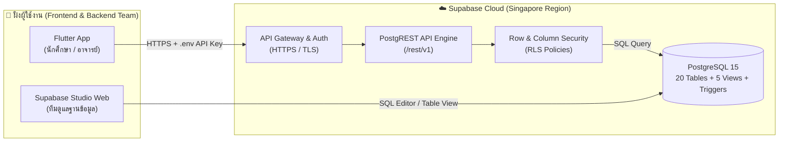
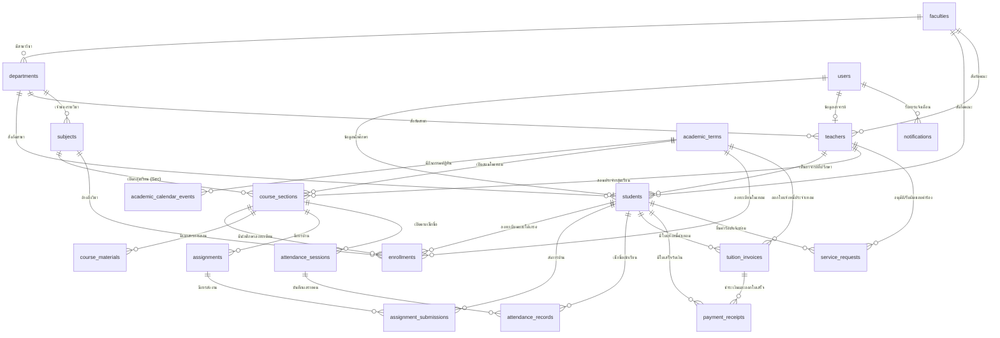

# 🗄️ คู่มือระบบฐานข้อมูลและ Backend (RMUTP Campus App Database Guide)

เอกสารฉบับนี้ออกแบบมาสำหรับ **ทีมพัฒนา Database & Backend** และ **ทีม Flutter Frontend** ของโปรเจกต์จบ **แอปพลิเคชันมหาวิทยาลัยเทคโนโลยีราชมงคลพระนคร (RMUTP Campus App)** รวมถึงใช้เป็นเอกสารอ้างอิงในเล่มปริญญานิพนธ์

---

## 📌 1. สถาปัตยกรรมของระบบ (Cloud Database Architecture)

ระบบฐานข้อมูลใช้ **Supabase Cloud (PostgreSQL 15 + PostgREST Automatic API + Row Level Security)** ซึ่งออนไลน์ตลอด 24 ชั่วโมง รองรับการทำงานร่วมกันของทีมพัฒนาได้จากทุกที่โดยไม่ต้องเปิดเครื่องเซิร์ฟเวอร์ส่วนตัวทิ้งไว้:



---

## 📂 2. โครงสร้างไฟล์ฐานข้อมูลในโปรเจกต์ (`supabase/migrations/`)

สคริปต์ SQL ทั้งหมดถูกจัดเก็บอย่างเป็นระบบตามมาตรฐาน **Database Migration** เพื่อให้ง่ายต่อการตรวจสอบและติดตั้ง:

| ลำดับไฟล์ | ชื่อไฟล์ | หน้าที่หลัก |
| :--- | :--- | :--- |
| **1** | [`supabase/migrations/01_schema.sql`](file:///e:/Project-APP_RMUTP/supabase/migrations/01_schema.sql) | สร้างโครงสร้างตารางหลัก **20 ตาราง** ตามหลัก **3NF**, Foreign Keys, Check Constraints และ Performance Indexes |
| **2** | [`supabase/migrations/02_views_and_triggers.sql`](file:///e:/Project-APP_RMUTP/supabase/migrations/02_views_and_triggers.sql) | สร้าง **Trigger คำนวณคะแนนรวมและตัดเกรดอัตโนมัติ** พร้อม **5 Views** สำเร็จรูป (`security_invoker = true`) |
| **3** | [`supabase/migrations/03_seed_mock_data.sql`](file:///e:/Project-APP_RMUTP/supabase/migrations/03_seed_mock_data.sql) | ข้อมูลจำลองเริ่มต้น (Mock Data) ของ มทร.พระนคร ครบทุกหน้าจอ |
| **4** | [`supabase/migrations/04_rls_security.sql`](file:///e:/Project-APP_RMUTP/supabase/migrations/04_rls_security.sql) | ตั้งค่าความปลอดภัยตามมาตรฐานสากล **Row Level Security (RLS)** ครบ 20 ตาราง และปิดกั้นคอลัมน์ `password_hash` |

---

## 🔐 3. มาตรฐานความปลอดภัยสากล (Security Best Practices)

1. **การจัดการ API Key ด้วย `.env` (Secret Management):**
   - ห้ามนำไฟล์ `.env` ที่มีคีย์จริงขึ้น GitHub โดยเด็ดขาด (ถูกบล็อกไว้ใน `.gitignore` เรียบร้อยแล้ว)
   - สำหรับเพื่อนในทีมที่เพิ่งดึงโปรเจกต์ไป ให้คัดลอกไฟล์ `.env.example` เป็น `.env` แล้วนำค่า `SUPABASE_URL` และ `SUPABASE_ANON_KEY` มาใส่
   - เวลาสั่งรันแอป Flutter ให้ใช้คำสั่ง:
     ```bash
     flutter run --dart-define-from-file=.env
     ```
2. **การเข้ารหัสรหัสผ่าน (Password Hashing):**
   - รหัสผ่านของผู้ใช้งานในตาราง `users` ถูกเข้ารหัสด้วยอัลกอริทึม **`bcrypt` (`pgcrypto`)** ไม่มีการเก็บรหัสผ่านเป็นตัวอักษรธรรมดา (Plaintext)
3. **การป้องกันระดับคอลัมน์และแถวข้อมูล (RLS & Column-Level Security):**
   - ใช้คำสั่ง `REVOKE SELECT (password_hash) ON public.users FROM anon, authenticated;` เพื่อป้องกันไม่ให้ใครสามารถดึงรหัสผ่านที่เข้ารหัสแล้วออกไปผ่าน REST API ได้
   - เปิดใช้งาน **Row Level Security (RLS)** ครบทั้ง 20 ตาราง และกำหนด `security_invoker = true` บน Views ทั้งหมด

---

## 📐 4. แผนภาพความสัมพันธ์ของข้อมูล (ER Diagram)

ฐานข้อมูลถูกออกแบบตามหลักการ **Normalization ระดับ 3NF (Third Normal Form)** แบ่งออกเป็น **8 โมดูล 20 ตารางหลัก** ดังนี้:



---

## 📋 5. พจนานุกรมข้อมูล (Data Dictionary — สรุปทั้ง 20 ตาราง)

### โมดูลที่ 1: โครงสร้างองค์กรและปฏิทินการศึกษา
1. **`faculties` (คณะวิชา):** เก็บรหัสคณะ (`ENG`, `BUS`, `SCI`), ชื่อไทย/อังกฤษ, ศูนย์พื้นที่ (เช่น ศูนย์พระนครเหนือ), อาคาร, เบอร์ติดต่อ
2. **`departments` (ภาควิชา/สาขาวิชา):** เก็บรหัสสาขา (`ENGCE`), ชื่อสาขา, ชื่อปริญญา และจำนวนหน่วยกิตตลอดหลักสูตร (`total_credits_required = 132`)
3. **`academic_terms` (ปีการศึกษาและภาคเรียน):** เก็บปี พ.ศ. (`2569`), เทอม (`1`, `2`, `3`), วันเปิด-ปิดเทอม, วันสอบกลางภาค-ปลายภาค, วันหมดเขตส่งเกรด และสถานะเทอมปัจจุบัน (`is_current`)
4. **`academic_calendar_events` (ปฏิทินการศึกษา):** เก็บกำหนดการสำคัญของมหาวิทยาลัย เช่น วันหมดเขตส่งงาน, วันปิดรับทุน, วันสอบ

### โมดูลที่ 2: ผู้ใช้งาน ประวัตินักศึกษา และบุคลากร
5. **`users` (บัญชีผู้ใช้งาน):** เก็บอีเมลมหาวิทยาลัย (`@rmutp.ac.th`), รหัสผ่านที่เข้ารหัสด้วย `bcrypt`, สิทธิ์ (`student`, `teacher`, `staff`, `admin`) และการตั้งค่าภาษา/แจ้งเตือน
6. **`teachers` (ข้อมูลอาจารย์):** เก็บรหัสอาจารย์ (`T-1024`), ตำแหน่งทางวิชาการ (`อ.`, `ผศ.`), ชื่อ-นามสกุล, รูปหน้าตรง, ห้องพักอาจารย์, เบอร์โทร, Line ID
7. **`students` (ประวัตินักศึกษาเชิงลึก):**
   - **ข้อมูลพื้นฐาน:** รหัสนักศึกษา (`650602001`), คำนำหน้า, ชื่อ-สกุล (ไทย/อังกฤษ), เลขบัตรประชาชน 13 หลัก, วันเกิด, กรุ๊ปเลือด
   - **รูปภาพยืนยันตัวตน:** ลิงก์รูปถ่ายหน้าตรงนักศึกษา (`face_photo_url`) และรูปบัตรนักศึกษาดิจิทัล (`student_card_url`)
   - **ข้อมูลวิชาการ:** คณะ, สาขา, อาจารย์ที่ปรึกษา (`advisor_id`), ชั้นปี, สถานะการศึกษา, เกรดเฉลี่ยสะสม (`gpax`), เกรดเทอมปัจจุบัน, หน่วยกิตสะสม (`earned_credits`)
   - **ที่อยู่และการติดต่อ:** เบอร์โทร, อีเมลส่วนตัว, Line ID, ที่อยู่หอพักปัจจุบัน, ที่อยู่ตามทะเบียนบ้าน, แขวง/เขต/จังหวัด/รหัสไปรษณีย์
   - **ผู้ติดต่อฉุกเฉิน:** ชื่อผู้ปกครอง, ความสัมพันธ์, เบอร์โทรศัพท์ฉุกเฉิน

### โมดูลที่ 3: รายวิชา ตารางเรียน และการตัดเกรด
8. **`subjects` (รายวิชา):** รหัสวิชา (`ENGCE302`), ชื่อวิชา, หน่วยกิต, ชั่วโมงบรรยาย-ปฏิบัติ-ศึกษาด้วยตนเอง, คำอธิบายรายวิชา
9. **`course_sections` (ตอนเรียน/กลุ่มเรียน):** กลุ่มเรียน (`Sec.1`, `Sec.2`), อาจารย์ผู้สอน, วัน-เวลาเรียน (`09:00–12:00`), ห้องเรียน (`ห้อง 1604`), จำนวนรับนักศึกษา, ความคืบหน้าการสอน (`course_progress`)
10. **`enrollments` (การลงทะเบียนและผลการเรียน):**
    - เก็บความสัมพันธ์ว่านักศึกษาคนไหนลงเรียนกลุ่มไหน
    - เก็บคะแนนย่อย (`quiz_score`, `lab_score`)
    - เก็บคะแนนหลัก: คะแนนเก็บ (`coursework_score /30`), สอบกลางภาค (`midterm_score /30`), สอบปลายภาค (`final_score /40`)
    - **มี Trigger อัตโนมัติ (`trg_auto_calculate_grade`):** คำนวณคะแนนรวม (`total_score /100`) และตัดเกรด (`A`, `B+`, `B`, `C+`, `C`, `D+`, `D`, `F`) พร้อมตั้งค่าแจ้งเตือน (`is_warning`) ทันทีที่มีการอัปเดตคะแนน!

### โมดูลที่ 4: เอกสารการสอนและการบ้าน
11. **`course_materials` (เอกสารการสอน):** เก็บชื่อสไลด์ (`สไลด์ Lec 6 — Normalization`), ประเภทไฟล์ (`PDF`), ขนาดไฟล์ และลิงก์ดาวน์โหลด
12. **`assignments` (งานที่สั่ง/การบ้าน):** ชื่องาน (`HW6: ออกแบบ ER + Normalization`), กำหนดส่ง (`due_date`), คะแนนเต็ม, จำนวนคนที่ส่งแล้ว
13. **`assignment_submissions` (การส่งงานของนักศึกษา):** เก็บลิงก์ไฟล์งานที่นักศึกษาอัปโหลดส่ง, เวลาที่ส่ง, สถานะ และคะแนนที่ได้

### โมดูลที่ 5: ระบบเช็กชื่อเข้าเรียน
14. **`attendance_sessions` (การเปิดห้องเช็กชื่อ):** เก็บรหัสห้องเช็กชื่อ (`DB-0921`), ข้อมูล QR Code, เวลาเปิด-ปิดห้อง และจำนวนคนเข้าเรียน
15. **`attendance_records` (ประวัติเช็กชื่อรายบุคคล):** เก็บสถานะ (`present` มา, `late` สาย, `absent` ขาด, `leave` ลา), เวลาที่กดเช็กชื่อ (`09:03`), วิธีเช็กชื่อ และสถานะการส่งแจ้งเตือนผ่านไลน์

### โมดูลที่ 6: การเงิน ค่าเทอม และใบเสร็จรับเงิน
16. **`tuition_invoices` (ใบแจ้งหนี้ค่าเทอม):** เลขที่ใบแจ้งหนี้ (`INV-2569-1-650602001`), ค่าหน่วยกิต, ค่าบำรุงมหาวิทยาลัย, ค่าห้องปฏิบัติการ, ส่วนลดทุนการศึกษา, ยอดรวมสุทธิ และสถานะการชำระเงิน
17. **`payment_receipts` (ใบเสร็จรับเงินและสลิปโอนเงิน):** เลขที่ใบเสร็จ (`RCP-2569-00891`), ช่องทางชำระเงิน (`qr_promptpay`, `mobile_banking`), ชื่อธนาคาร, เลขที่อ้างอิงสลิป, ลิงก์รูปภาพสลิปโอนเงิน (`slip_image_url`) และลิงก์ไฟล์ใบเสร็จอิเล็กทรอนิกส์ (`receipt_pdf_url`)

### โมดูลที่ 7 & 8: คำร้อง ข่าวสาร และการแจ้งเตือน
18. **`service_requests` (คำร้องและแจ้งซ่อม):** รหัสคำร้อง (`#RQ-1042`), ประเภท (`document`, `repair`, `complaint`), หัวข้อ, รายละเอียด, ห้องที่แจ้งซ่อม, รูปแนบ, ลิงก์เอกสาร PDF ที่อนุมัติแล้ว (เช่น Transcript) และเปอร์เซ็นต์ความคืบหน้า
19. **`news_announcements` (ข่าวสารและทุน):** หัวข้อข่าว, ประเภท (`ทุน`, `ฝึกงาน`, `กิจกรรม`), รายละเอียด, เกรดขั้นต่ำที่สมัครได้ (`min_gpa_required`)
20. **`notifications` (การแจ้งเตือน):** หัวข้อแจ้งเตือน, รายละเอียด, สีป้ายแจ้งเตือน และสถานะการอ่าน (`is_read`)

---

## 🔌 6. ตัวอย่างการเรียกใช้งาน API สำหรับทีม Backend & Flutter

### ข้อมูลการเชื่อมต่อ (ผ่าน [`DatabaseConfig`](file:///e:/Project-APP_RMUTP/lib/services/database_config.dart)):
- **Base REST URL:** `${DatabaseConfig.restApiUrl}`
- **Headers มาตรฐาน:** `DatabaseConfig.defaultHeaders`

### ตัวอย่าง Endpoint สำเร็จรูป:
1. **ดึงข้อมูลโปรไฟล์นักศึกษาฉบับเต็ม (รหัส 650602001):**
   ```http
   GET /rest/v1/v_student_profiles?student_id=eq.650602001
   ```
2. **ดึงตารางเรียนของนักศึกษาในเทอมปัจจุบัน:**
   ```http
   GET /rest/v1/v_student_timetable?student_id=eq.650602001
   ```
3. **ดึงใบกรอกคะแนนและตัดเกรดสำหรับอาจารย์ (วิชา ENGCE302):**
   ```http
   GET /rest/v1/v_teacher_grade_sheet?subject_code=eq.ENGCE302
   ```
4. **ดึงประวัติค่าเทอมและใบเสร็จรับเงินของนักศึกษา:**
   ```http
   GET /rest/v1/v_student_financial_records?student_id=eq.650602001
   ```
5. **ดึงรายการคำร้องของนักศึกษา:**
   ```http
   GET /rest/v1/service_requests?student_id=eq.650602001&order=created_at.desc
   ```
6. **อัปเดตคะแนนสอบของนักศึกษา (Trigger จะคำนวณคะแนนรวมและตัดเกรดให้อัตโนมัติ!):**
   ```http
   PATCH /rest/v1/enrollments?student_id=eq.650602002&subject_code=eq.ENGCE302
   Content-Type: application/json

   {
     "midterm_score": 25,
     "final_score": 32,
     "coursework_score": 26,
     "grade_submit_status": "ส่งแล้ว"
   }
   ```
