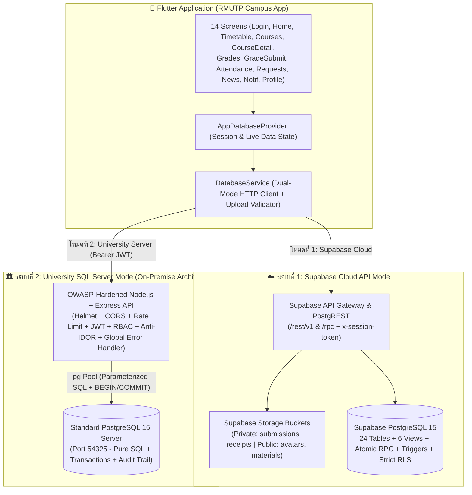

# 🗄️ คู่มือระบบฐานข้อมูลมหาวิทยาลัย 2 ระบบและมาตรฐานความปลอดภัย (RMUTP Dual-Database & OWASP Security Guide)

เอกสารฉบับนี้ออกแบบมาสำหรับ **ทีมพัฒนา Database & Backend** และ **ทีม Flutter Frontend** ของโปรเจกต์จบ **แอปพลิเคชันมหาวิทยาลัยเทคโนโลยีราชมงคลพระนคร (RMUTP Campus App)** โดยรองรับการทำงาน **2 ระบบควบคู่กัน (Dual-Database Architecture)** พร้อมผ่านการยกระดับความปลอดภัยตามมาตรฐาน **OWASP Top 10** และ **CWE Top 25**

---

## 📌 1. สถาปัตยกรรม 2 ระบบควบคู่กัน (Dual-System Architecture)



---

## 🛡️ 2. มาตรฐานความปลอดภัย OWASP Top 10 & CWE Top 25 (Security Hardening Checklist)

| ด้านความปลอดภัย | มาตรฐานที่รองรับ | กลไกที่พัฒนาในระบบจริง |
| :--- | :--- | :--- |
| **1. ป้องกัน SQL Injection & Transaction** | `CWE-89` | ใช้ Parameterized Queries (`$1, $2`) ร่วมกับ Resource/Column Whitelist ใน `server.js` และครอบการส่งเกรด/เช็กชื่อ/ส่งงานด้วย Transaction (`BEGIN ... COMMIT / ROLLBACK` และ `FOR UPDATE`) |
| **2. ป้องกันปลอมสิทธิ์และข้ามบัญชี (Anti-IDOR & RBAC)** | `CWE-285`, `CWE-639` | - **Express API:** ออก HMAC-SHA256 JWT + Middleware `requireAuth` & `requireRole` และบังคับใช้ `req.user.student_id` จาก JWT เสมอ (ส่งรหัสเพื่อนมาโดน `403 Forbidden`)<br>- **Supabase Cloud:** เปิด **RLS ครบทั้ง 24 ตาราง** พร้อมตรวจสิทธิ์ผ่าน `auth.uid()` และ `x-session-token` (`user_sessions` เก็บ SHA-256 hash) |
| **3. คุ้มครองข้อมูลส่วนบุคคล (PDPA) และรหัสผ่าน** | `CWE-312`, `CWE-200` | - รหัสผ่านเข้ารหัสด้วย `bcrypt` **Salt Rounds = 10** (`gen_salt('bf', 10)`)<br>- ปิดกั้นคอลัมน์ `password_hash` และ `citizen_id` ดิบด้วย `REVOKE SELECT`<br>- ปกปิดเลขบัตรประชาชนใน `v_student_profiles` ด้วย `fn_mask_citizen_id()` เป็นรูปแบบ `1-xxxx-xxxxx-xx-x` |
| **4. ป้องกันการโกงเช็กชื่อและส่งงาน** | Business Logic Security | - `sp_check_in_attendance`: ใช้เวลา `NOW() AT TIME ZONE 'Asia/Bangkok'` ของ **Database Server เท่านั้น** ตรวจ `is_open = TRUE` และมี `UNIQUE(session_id, student_id)` ห้ามเช็กชื่อซ้ำ<br>- `sp_submit_assignment`: ตัดสิน `submitted` vs `late` จาก `NOW() > due_date` บน Server เท่านั้น |
| **5. API Hardening, Rate Limit & Input Validation** | `CWE-20`, `CWE-307` | - ติดตั้ง `helmet` (Security Headers), ตั้งค่า `cors`, จำกัด Payload `1mb`<br>- ติดตั้ง `express-rate-limit`: Login สูงสุด `10 ครั้ง/15 นาที`, Check-in สูงสุด `15 ครั้ง/5 นาที`<br>- ตรวจขอบเขตคะแนนทั้งใน Express API และ `CHECK` Constraints ใน PostgreSQL (`quiz 0-15`, `lab 0-25`, `coursework 0-30`, `midterm 0-30`, `final 0-40`) |
| **6. ความปลอดภัยไฟล์อัปโหลด & Storage** | `CWE-434` | - อนุญาตเฉพาะ `.pdf`, `.png`, `.jpg`, `.jpeg`, `.docx` ขนาดไม่เกิน **5 MB** (`5242880` bytes)<br>- เปลี่ยนชื่อไฟล์เป็น `<student_id>_<timestamp>_<uuid>.<ext>` ป้องกัน Path Traversal<br>- ตั้ง `submissions` และ `receipts` เป็น **Private Buckets (`public = false`)** บน Supabase Storage |
| **7. Audit Trail & ซ่อน Error ภายใน** | `CWE-209`, `CWE-778`, `CWE-798` | - สร้างตาราง `audit_logs` พร้อม Trigger บันทึกประวัติอัตโนมัติเมื่อแก้คะแนน/ส่งเกรด (`UPDATE_GRADE`), อนุมัติคำร้อง (`UPDATE_REQUEST_STATUS`), ล็อกอิน, เช็กชื่อ, ส่งงาน<br>- Global Error Handler ใน Express ซ่อน SQL Error & Stack Trace จาก Client<br>- บล็อก `.env`, `node_modules/`, `*.pem`, `*.key` ใน `.gitignore` |

---

## 📂 3. โครงสร้างไฟล์ฐานข้อมูลและ Backend ในโปรเจกต์

| ระบบ / ส่วนประกอบ | ที่อยู่ไฟล์ | หน้าที่หลัก |
| :--- | :--- | :--- |
| **ระบบที่ 1: Supabase Cloud** | [full_supabase_setup.sql](file:///e:/Project-APP_RMUTP/database/supabase_cloud/full_supabase_setup.sql) | สคริปต์ **All-in-One SQL (Hardened)** (24 ตาราง + 6 Views + 4 Stored Functions/RPC + Audit Triggers + Private/Public Storage Buckets + ข้อมูลจำลอง + Strict RLS) |
| **ระบบที่ 2: University SQL** | [01_standard_sql_setup.sql](file:///e:/Project-APP_RMUTP/database/university_sql_server/01_standard_sql_setup.sql) | สคริปต์ **Pure Standard PostgreSQL 15** สำหรับเซิร์ฟเวอร์จริงของมหาวิทยาลัย (ไม่มีคำสั่งเฉพาะของ Supabase) |
| **ระบบที่ 2: Express Middleware** | [server.js](file:///e:/Project-APP_RMUTP/database/university_sql_server/api_server/server.js) | **Node.js + Express REST API** พร้อม `helmet`, `express-rate-limit`, JWT Auth, RBAC, Anti-IDOR, Transactions และ Global Error Handler |
| **ระบบที่ 2: Docker จำลอง ม.** | [docker-compose.university.yml](file:///e:/Project-APP_RMUTP/database/university_sql_server/docker-compose.university.yml) | ชุดรันจำลองเซิร์ฟเวอร์ PostgreSQL ของมหาวิทยาลัยคู่กับ Express API บนพอร์ต `4000` |
| **การตั้งค่า Flutter DB** | [database_config.dart](file:///e:/Project-APP_RMUTP/lib/services/database_config.dart) | จัดการสลับโหมด 2 ระบบ และแนบ `Authorization: Bearer` / `x-session-token` |
| **Service & State กลาง** | [database_service.dart](file:///e:/Project-APP_RMUTP/lib/services/database_service.dart) / [app_database_provider.dart](file:///e:/Project-APP_RMUTP/lib/providers/app_database_provider.dart) | ยิง RPC/REST API, ตรวจไฟล์อัปโหลด, และทำ PDPA Masking |

---

## 📐 4. พจนานุกรมข้อมูลฉบับสมบูรณ์ (24 Tables, 6 Views, Triggers, RPC & Storage)

ฐานข้อมูลออกแบบตามหลัก **Normalization ระดับ 3NF (Third Normal Form)** แบ่งเป็น **8 โมดูลหลัก + ระบบ Security & Audit**:

| โมดูล | ตาราง (Tables) | คำอธิบายข้อมูลสำคัญ |
| :--- | :--- | :--- |
| **1. โครงสร้างมหาวิทยาลัย** | `faculties`, `departments`, `curriculums`, `buildings_rooms` | คณะวิชา 4 คณะ, สาขาวิชา 6 สาขา, หลักสูตรการศึกษา (`B.Eng-CE-2565`), อาคารและห้องเรียนจริง |
| **2. ปฏิทินการศึกษา** | `academic_terms`, `academic_calendar_events` | ปีการศึกษา/ภาคเรียน (`2/2568`, `1/2569`), วันสอบกลางภาค-ปลายภาค, วันหมดเขตส่งเกรด, ปฏิทินวิชาการ |
| **3. ผู้ใช้และทะเบียนประวัติ** | `users`, `teachers`, `students`, `user_sessions` | บัญชีผู้ใช้ (`bcrypt` cost 10), อาจารย์ 4 ท่าน (`T-1024`–`T-1027`), ประวัตินักศึกษา 12 คน (`650602001`–`650602012`), และ Session Token (SHA-256) |
| **4. รายวิชาและผลการเรียน** | `subjects`, `course_sections`, `enrollments` | รายวิชา 9 วิชา, กลุ่มเรียนจันทร์–ศุกร์ (`MON`–`FRI`), คะแนนเก็บ/กลางภาค/ปลายภาคพร้อม `CHECK` Constraints, เกรด (`A`–`F`) |
| **5. สื่อการสอนและการบ้าน** | `course_materials`, `assignments`, `assignment_submissions` | สไลด์ PDF, การบ้าน (`HW6`, `Lab 6`), การส่งงานพร้อม `file_size_bytes <= 5MB` และ `mime_type` Whitelist |
| **6. ระบบเช็กชื่อเข้าเรียน** | `attendance_sessions`, `attendance_records` | ห้องเช็กชื่อ (`DB-0921`), QR Payload, สถานะรายคน พร้อม `UNIQUE(session_id, student_id)` |
| **7. การเงินและใบเสร็จ** | `tuition_invoices`, `payment_receipts` | ใบแจ้งหนี้ค่าเทอม, ส่วนลดทุน, ใบเสร็จอิเล็กทรอนิกส์ (`e-Receipt`) และสลิปโอนเงิน |
| **8. คำร้อง ข่าวสาร แจ้งเตือน & Audit** | `service_requests`, `news_announcements`, `notifications`, `audit_logs` | คำร้องขอเอกสาร/แจ้งซ่อม, ข่าวสาร, การแจ้งเตือน และ **`audit_logs` (บันทึกประวัติแก้คะแนน/อนุมัติคำร้อง/เช็กชื่อ/ล็อกอิน)** |

### Views, Triggers, Stored Procedures & Storage Buckets
- **6 Database Views (`WITH (security_invoker = true)`):** `v_student_profiles` (Masked `citizen_id`), `v_student_timetable`, `v_teacher_timetable`, `v_teacher_grade_sheet`, `v_student_grades`, `v_student_financial_records`
- **Triggers:**
  - `trg_auto_calculate_grade`: คำนวณคะแนนรวมและตัดเกรด `A`–`F` อัตโนมัติ
  - `trg_audit_enrollments_changes` & `trg_audit_service_requests_changes`: บันทึกค่าเก่า-ค่าใหม่ลง `audit_logs` อัตโนมัติ
- **Stored Functions / RPCs (`SECURITY DEFINER`):**
  - `sp_authenticate_user(p_email, p_password)` (`SET search_path = public, extensions`) — ตรวจสอบรหัสผ่าน `bcrypt` และออก `session_token`
  - `sp_check_in_attendance(p_session_id, p_student_id, p_method)` — เช็กชื่อด้วยเวลา `NOW()` ของ Server เท่านั้น + ป้องกันเช็กซ้ำและ IDOR
  - `sp_submit_assignment(p_assignment_id, p_student_id, p_original_filename, p_file_size_bytes, p_mime_type)` — ตรวจไฟล์ + เปลี่ยนชื่อ UUID + เทียบ `due_date` บน Server
  - `sp_submit_section_grades(p_teacher_id, p_subject_code, p_grades, p_submit_final)` — บันทึกเกรด + อัปเดต GPAX ใน Transaction เดียว
- **4 Supabase Storage Buckets:** `avatars` (Public, 5MB), `materials` (Public, 10MB), **`submissions` (Private, 5MB)**, **`receipts` (Private, 5MB)**

---

## 🛠️ 5. คู่มือการอัปเดตบน Supabase Cloud และวิธีรันแอป

### ก. อัปเดตฐานข้อมูลบน Supabase Cloud
1. เปิด **SQL Editor ➡️ + New query** ในโปรเจกต์ Supabase ของคุณ
2. คัดลอกโค้ดทั้งหมดจาก [full_supabase_setup.sql](file:///e:/Project-APP_RMUTP/database/supabase_cloud/full_supabase_setup.sql) ไปวางแล้วกด **Run** (ไฟล์ออกแบบให้รันซ้ำทับของเดิมได้ปลอดภัย 100%)
3. ตั้งค่า `SUPABASE_URL` และ `SUPABASE_ANON_KEY` ในไฟล์ `.env` (คัดลอกมาจาก [.env.example](file:///e:/Project-APP_RMUTP/.env.example))

### ข. วิธีรันแอป Flutter และระบบที่ 2 (Express Middleware)
- **รันแอป (เชื่อมต่อ Supabase Cloud):** กดปุ่ม **`F5`** ใน VS Code (ผ่าน [.vscode/launch.json](file:///e:/Project-APP_RMUTP/.vscode/launch.json)) หรือรันคำสั่ง:
  ```powershell
  flutter run -d chrome --dart-define-from-file=.env
  ```
- **รันระบบที่ 2 (เซิร์ฟเวอร์ PostgreSQL มหาวิทยาลัย + Express JWT API):**
  ```powershell
  docker-compose -f database/university_sql_server/docker-compose.university.yml up -d --build
  ```

---

## 🔑 6. รายชื่อบัญชีผู้ใช้งานจริงในฐานข้อมูล (16 บัญชี)

ทุกบัญชีใช้รหัสผ่านเดียวกันคือ **`password123`** (เข้ารหัสด้วย `bcrypt` Salt Rounds = 10):

| บทบาท | อีเมลมหาวิทยาลัย | รหัสประจำตัว | ชื่อ - นามสกุล | ข้อมูลหลักในระบบ |
| :--- | :--- | :--- | :--- | :--- |
| **นักศึกษา** | `s650602001@rmutp.ac.th` – `s650602012@rmutp.ac.th` | `650602001` – `650602012` | น.ส.มินตรา ใจดี และเพื่อนร่วมห้อง Sec.1 (12 คน) | วศ.บ. วิศวกรรมคอมพิวเตอร์ ปี 2 |
| **อาจารย์** | `surachai.w@rmutp.ac.th` | `T-1024` | อ.สุรชัย วงศ์ใหญ่ | สอน `ENGCE302`, `ENGCE306` • ที่ปรึกษาปี 2 |
| **อาจารย์** | `naphat.c@rmutp.ac.th` | `T-1025` | ผศ.นภัส เจริญผล | สอน `ENGCE305`, `ENGCE303` |
| **อาจารย์** | `kittipong.t@rmutp.ac.th` | `T-1026` | รศ.ดร.กิตติพงศ์ ธีรเมธ | สอน `ENGCE307`, `ENGCE308` |
| **อาจารย์** | `praewpan.s@rmutp.ac.th` | `T-1027` | อ.ดร.แพรวพรรณ ศิริกุล | สอน `GEN101`, `MATH201` |
